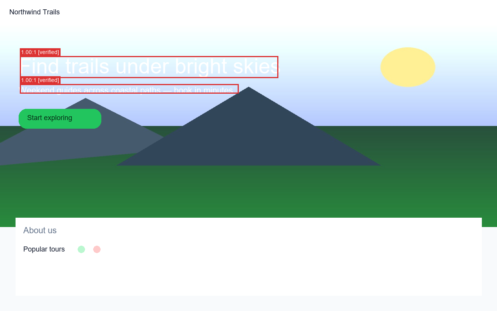
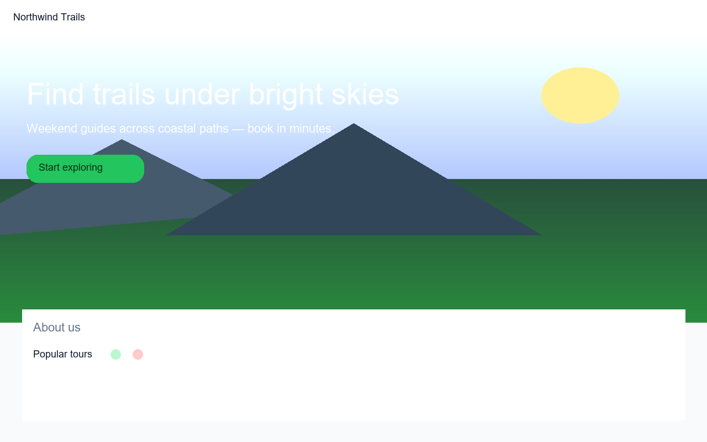
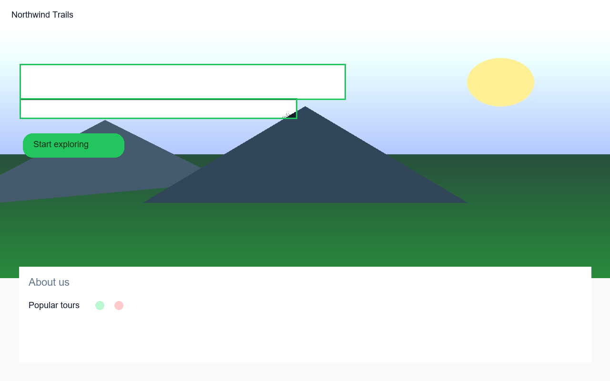
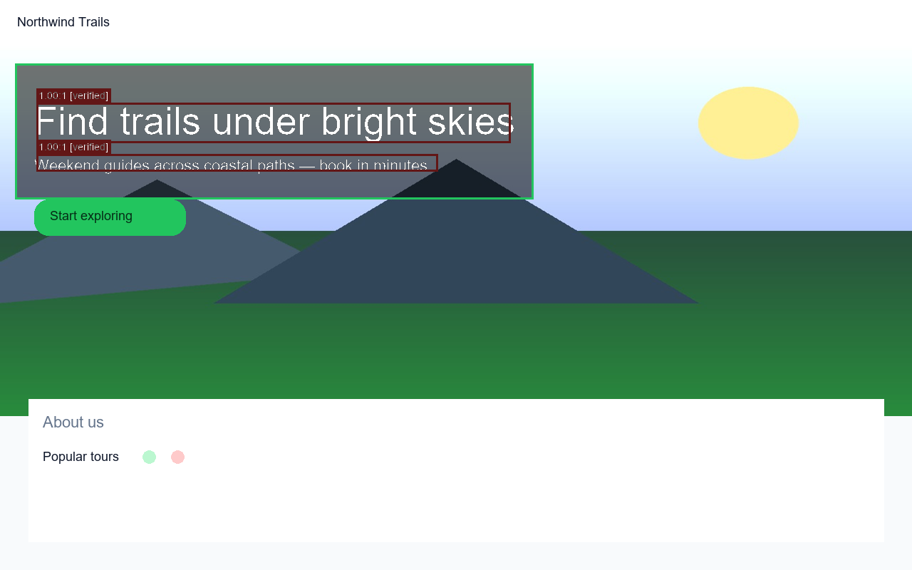

# RenderLens

axe checks the DOM. Gemma sees the render.

RenderLens is a screenshot-first accessibility auditor for problems that are hard to catch from HTML alone.

It sends the rendered UI to Gemma 4 for visual analysis, then uses deterministic WCAG calculations to verify contrast-related findings. Visual findings that cannot be mathematically verified stay clearly labeled as model observations.



| Before | Auto-fix preview |
| --- | --- |
|  |  |

Dogfood on the annotated output (same hero, second pass): 

## What it catches

- Text over images and gradients
- Low-contrast text in real visual context
- Truncation
- Weak visual hierarchy
- Color-only meaning

The last three are reported as model-observed findings unless deterministic evidence is available.

## How it works

```
Screenshot
    ↓
Gemma 4
    ↓
Visual findings
    ↓
WCAG / pixel verification
    ↓
Verified · Model-observed · Dropped
    ↓
Annotated image + HTML / JSON / Markdown report
```

For contrast findings, RenderLens samples the relevant pixels and recomputes the WCAG ratio instead of trusting the model's claim.

## Finding tiers

| Tier | Meaning |
| --- | --- |
| Verified | Supported by deterministic contrast checks |
| Model-observed | Visual issue from Gemma, kept after a second look |
| Dropped | Contradicted by deterministic evidence |

## Quickstart

```bash
python -m venv .venv

# Windows
.venv\Scripts\activate

pip install -e .

copy .env.example .env
# Add GEMINI_API_KEY to .env

renderlens audit examples/screenshots/demo_hero.png --out out/demo
```

This writes an annotated screenshot and an HTML report under `out/demo`.

Exit code is non-zero when verified critical/serious findings are present.

## Local backend

Optional Ollama backend:

```bash
renderlens audit path/to.png --backend ollama --model gemma3:4b
```

This path uses Gemma 3, not Gemma 4.

## Auto-fix preview

- Solid backgrounds: suggest a text color that keeps the hue and reaches WCAG AA.
- Images and gradients: add a scrim behind the text and recompute contrast.

The preview shows what a visual fix could look like. It does not edit your application source.

## Evaluation

The repo includes a small synthetic evaluation set with controlled accessibility defects.

```bash
python eval/generate_dataset.py
python eval/run_eval.py
```

See [docs/evaluation.md](docs/evaluation.md) for methodology and latest results.

## axe-core comparison

RenderLens does not replace axe-core.

axe-core is useful for DOM-level checks. RenderLens focuses on visual context that is hard to judge from the DOM alone, such as text over images or gradients.

On our demo page, axe reported 1 color-contrast violation and 1 incomplete color-contrast review. Details: [docs/assets/axe_demo_summary.md](docs/assets/axe_demo_summary.md).

## Agent Skill

An Agent Skill is included under `skill/renderlens/`. It follows the Agent Skill format.

## Development

```
src/
tests/
examples/
eval/
docs/
skill/
.github/
```

```bash
pytest
```

## License

MIT
